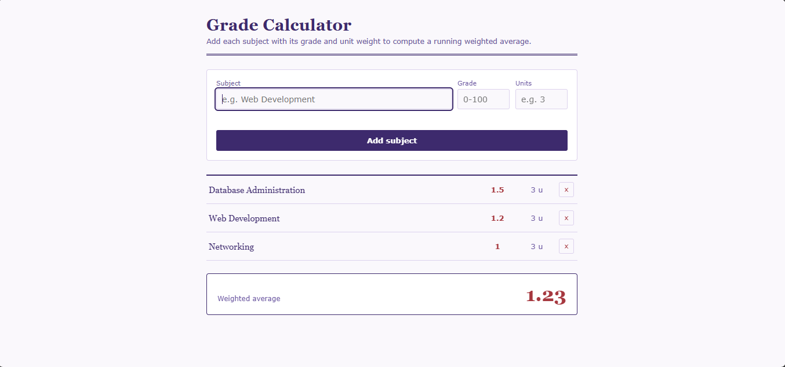

# Grade Calculator

A simple web page that lets you add subjects with a grade and unit weight, then shows the weighted average automatically. Built with plain HTML, CSS, and JavaScript — no frameworks, no page reloads.

## Features

- Add a subject with its grade and units through a form
- Remove a subject with the delete button
- Weighted average updates automatically as you add or remove subjects
- Color-coded grades (low / mid / high)

## Files

- `index.html` — page structure
- `style.css` — styling
- `script.js` — logic (events, DOM updates, array handling)

## How it works

- `form.addEventListener('submit', ...)` adds a new subject and stops the page from reloading with `event.preventDefault()`
- `ledger.addEventListener('click', ...)` removes a subject when its delete button is clicked
- `subjects.push()` adds a subject to the array
- `subjects.filter()` removes a subject from the array
- `subjects.map()` and `reduce()` calculate the weighted average

## How to use

1. Open `index.html` in a browser
2. Fill in subject, grade, and units
3. Click "Add subject"
4. Click the × button to remove a subject

## Live demo

https://francheskalanip.github.io/GradeCalculator/